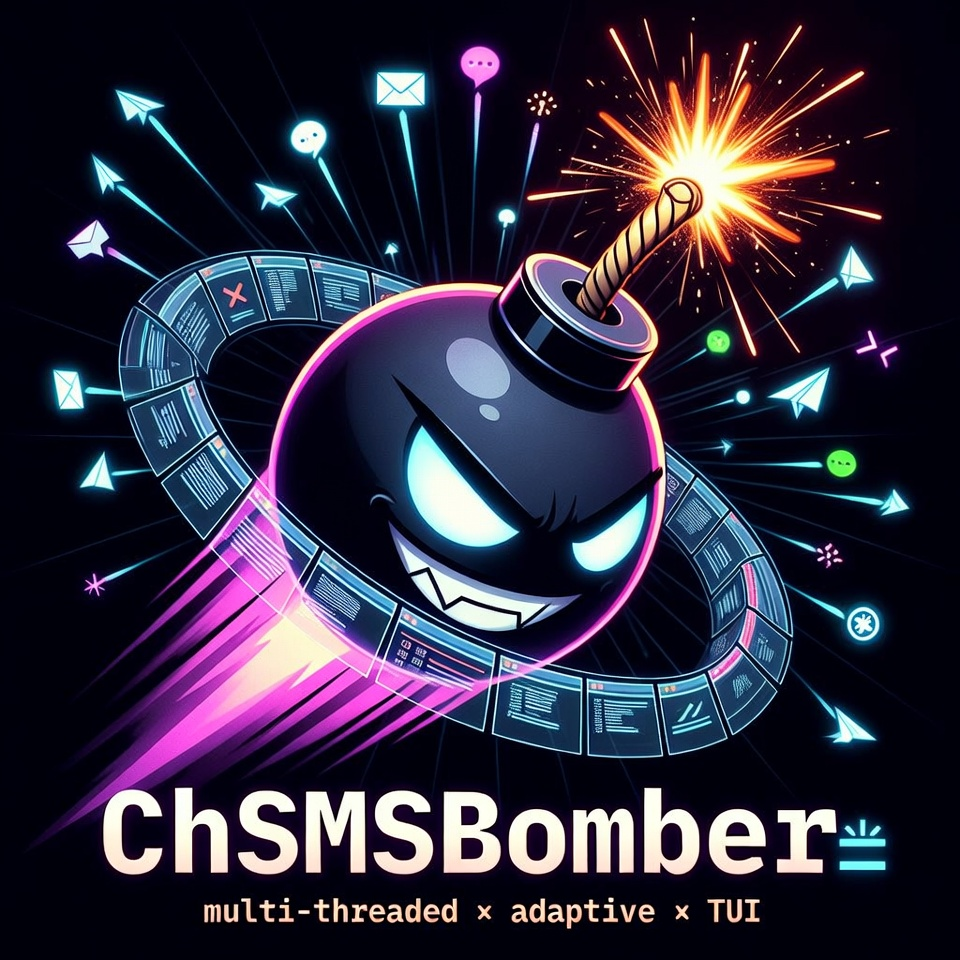
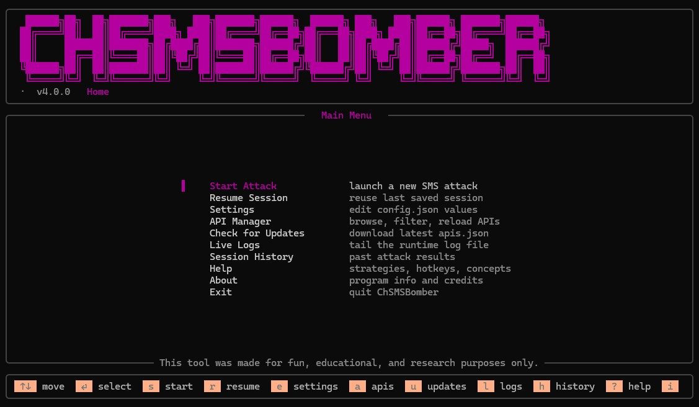
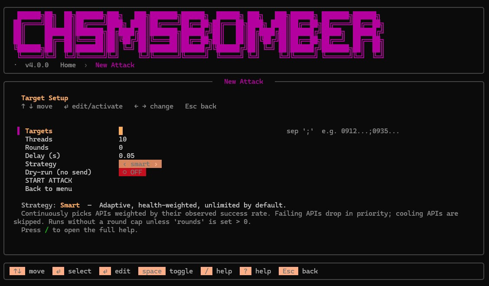
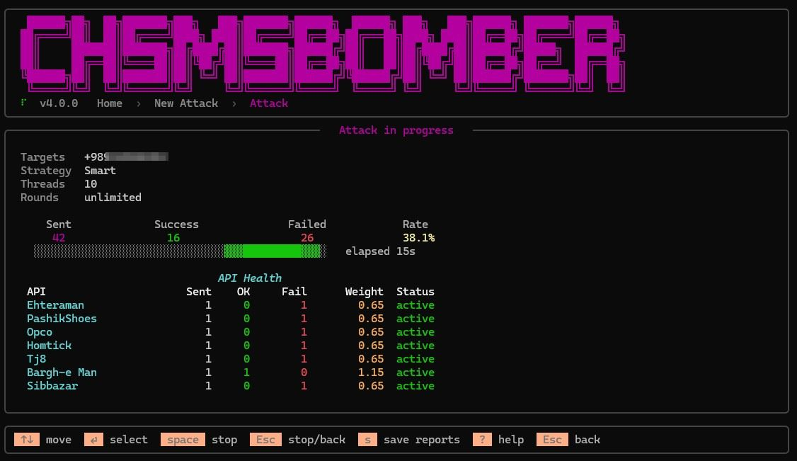
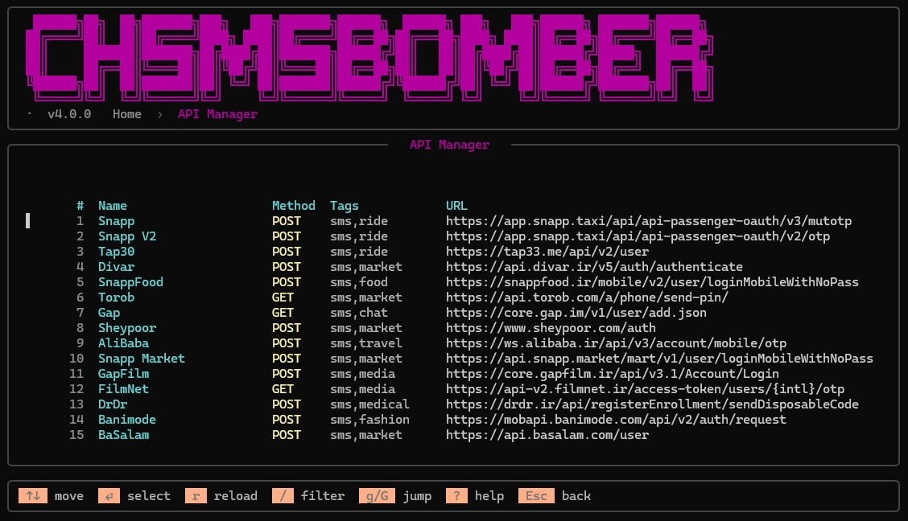
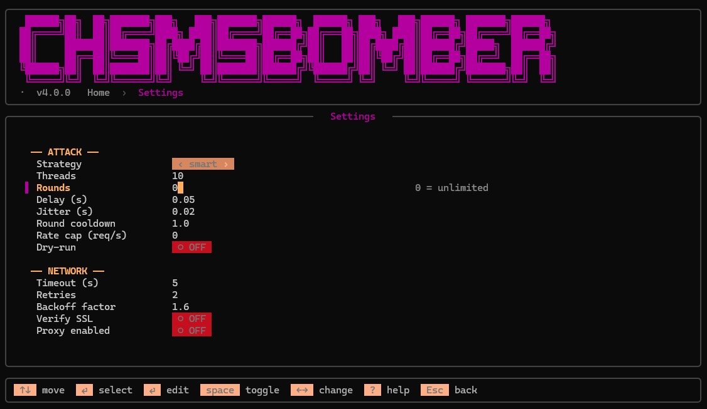
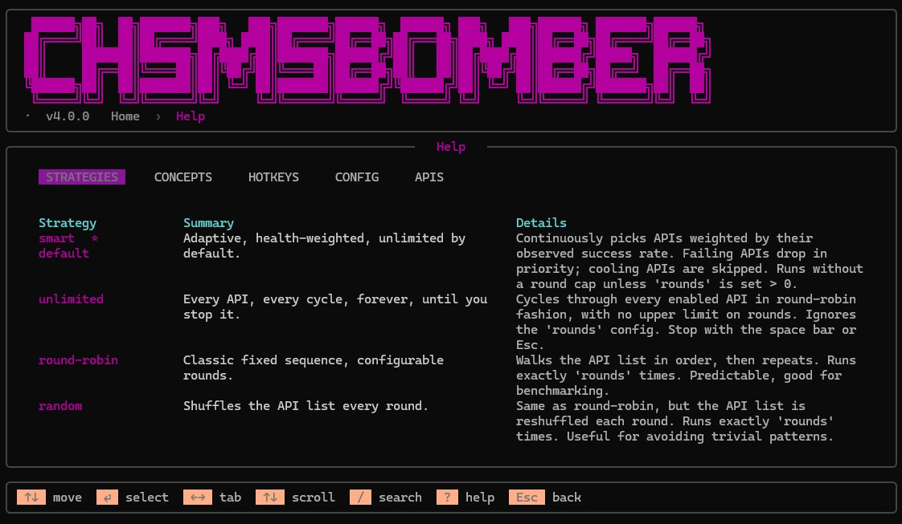

<div align="center">



### Multi-threaded SMS prank tool with a keyboard-driven terminal UI

<br>

[](#)
[](#-license)
[](#-changelog)
[](#-installation)
[](#-contributing)

<br>

**ChSMSBomber** is a fast, configurable, terminal-native SMS stress-testing tool.<br>
It cycles through Iranian OTP-enabled service endpoints to send test SMS messages<br>
to a target phone number — with adaptive strategies, live health tracking,<br>
response-body verification, and a fully keyboard-driven TUI.

<br>

[Features](#-features) · [Installation](#-installation) · [Usage](#-usage) · [Configuration](#-configuration) · [Strategies](#-strategies) · [API Registry](#-api-registry) · [FAQ](#-faq) · [License](#-license)

</div>

---

## ✦ Table of Contents

- [Features](#-features)
- [Screenshots](#-screenshots)
- [Installation](#-installation)
- [Usage](#-usage)
- [Hotkeys](#-hotkeys)
- [Configuration](#-configuration)
- [Strategies](#-strategies)
- [API Registry](#-api-registry)
- [Project Structure](#-project-structure)
- [Reports](#-reports)
- [FAQ](#-faq)
- [Contributing](#-contributing)
- [License](#-license)
- [Disclaimer](#-disclaimer)

---

## ✦ Features

<table>
<tr>
<td width="50%" valign="top">

### 🎯 Core
- **Multi-threaded** — configurable worker pool
- **Multi-target** — attack many numbers at once
- **Adaptive strategies** — smart, unlimited, round-robin, random
- **Response-body verification** — no fake successes from 2xx JSON errors
- **Live API health** — per-endpoint failure tracking with cooldown
- **Smart weighting** — success-rate-driven API selection

</td>
<td width="50%" valign="top">

### 🎨 UI / UX
- **Keyboard-driven TUI** — arrows, Enter, Esc, hotkeys everywhere
- **Live dashboard** — spinner, counters, progress bar, API table
- **Inline form editor** — edit settings without a config file
- **Toast notifications** — non-blocking status messages
- **Session history** — every attack logged locally
- **Live log tail** — watch the runtime log in real time

</td>
</tr>
<tr>
<td width="50%" valign="top">

### ⚙️ Configuration
- **External `config.json`** — every value editable in-TUI
- **External `apis.json`** — add/remove endpoints without touching code
- **Placeholder tokens** — `{cc}` `{intl}` `{local}` `{ts}` `{ua}`
- **Per-API headers** — full header control per endpoint
- **Tag filtering** — attack only SMS, or only a specific service
- **Proxy pool** — route through rotating proxies

</td>
<td width="50%" valign="top">

### 📦 Output & Tooling
- **JSON / CSV / HTML reports** — auto-saved per attack
- **Rotating logs** — 5 MB × 3 backups
- **Session persistence** — resume any saved attack
- **Dry-run mode** — plan an attack without sending
- **Rate limiter** — global req/sec cap
- **Graceful stop** — space bar, no orphan threads

</td>
</tr>
</table>

---

## ✦ Screenshots

<div align="center">

### 🖥️ A look at the interface

<br>

<table>
<tr>
<td width="33.33%" align="center" valign="top">

<h4>Main Menu</h4>



<sub>Arrow keys · hotkeys on every screen</sub>

</td>
<td width="33.33%" align="center" valign="top">

<h4>Start Settings</h4>



<sub>Input fields · fully customizable</sub>

</td>
<td width="33.33%" align="center" valign="top">

<h4>Live Attack</h4>



<sub>Live spinner · progress bar · API table</sub>

</td>
</tr>
</table>

<br>

<table>
<tr>
<td width="33.33%" align="center" valign="top">

<h4>API Manager</h4>



<sub>Live filter · per-API headers · reload</sub>

</td>
<td width="33.33%" align="center" valign="top">

<h4>Settings Editor</h4>



<sub>Every value editable in-place · no file editing required</sub>

</td>
<td width="33.33%" align="center" valign="top">

<h4>Help — Strategies</h4>



<sub>Working tab navigation · scroll · search</sub>

</td>
</tr>
</table>

</div>

---

## ✦ Installation

### Requirements

- **Python 3.10** or newer
- A terminal with 24-bit colour support (Windows Terminal, iTerm2, Kitty, Alacritty, WezTerm)

### Quick start

```bash
# Clone the repository
git clone https://github.com/Ch4120N/Charon-SMS-Bomber.git
cd Charon-SMS-Bomber

# Create a virtual environment
python -m venv venv
source venv/bin/activate     # Windows: venv\Scripts\activate

# Install dependencies
pip install -r requirements.txt

# Run
python ChSMSBomber.py
```

### Optional flags

```bash
python ChSMSBomber.py --config /path/to/alternate_config.json
```

---

## ✦ Usage

ChSMSBomber is fully keyboard-driven. There are no typed prompts — every interaction uses arrow keys and hotkeys.

```
1. Launch the app
2. Select  Start Attack  (or press  s )
3. Enter targets        (up to N phone numbers, semicolon-separated)
4. Pick a strategy      (default: smart)
5. Configure threads, rounds, delay
6. Press  Enter  on  START ATTACK
7. Watch the live dashboard
8. Press  s  after completion to export reports
```

---

## ✦ Hotkeys

### Global

| Key | Action |
|:---:|:---|
| `?` | Open help screen (from any screen) |
| `Esc` | Back / cancel edit / stop attack |
| `q` | Quit (main menu only) |

### Navigation

| Key | Action |
|:---:|:---|
| `↑` `↓` / `k` `j` | Move cursor |
| `←` `→` | Change cycle fields · switch help tabs |
| `⏎` | Select / activate / edit |
| `Space` | Toggle boolean |
| `g` / `G` | Jump to first / last item |
| `/` | Search or filter |

### Screen shortcuts (from main menu)

| Key | Screen |
|:---:|:---|
| `s` | Start attack |
| `r` | Resume last session |
| `e` | Settings |
| `a` | API Manager |
| `u` | Check for API updates |
| `l` | Live logs |
| `h` | Session history |
| `i` | About |

### Attack screen

| Key | Action |
|:---:|:---|
| `Space` | Stop the attack |
| `Esc` | Stop and return |
| `s` | Save JSON + CSV + HTML reports |

---

## ✦ Configuration

ChSMSBomber ships with a **`config.json`** auto-created on first run. Every value is editable from the Settings screen (`e` on the main menu) — or by hand.

```json
{
    "version": "5.0.0",
    "network": {
        "timeout": 5,
        "retries": 2,
        "retry_backoff": 1.6,
        "verify_ssl": false,
        "proxy_enabled": false,
        "proxy_pool": []
    },
    "attack": {
        "threads": 10,
        "rounds": 0,
        "delay": 0.05,
        "jitter": 0.02,
        "strategy": "smart",
        "hard_max_rounds": 100,
        "round_cooldown": 1.0,
        "rate_limit_per_sec": 0,
        "dry_run": false,
        "api_filter_tags": [],
        "api_filter_enabled_only": true
    },
    "user_agent": {
        "rotate": true,
        "custom": []
    },
    "api_health": {
        "enabled": true,
        "failure_threshold": 5,
        "cooldown_seconds": 60
    },
    "ui": {
        "refresh_per_second": 30,
        "idle_refresh_per_second": 4,
        "idle_after_seconds": 1.5,
        "show_banner": true
    },
    "logging": {
        "enabled": true,
        "level": "INFO",
        "max_bytes": 5242880,
        "backup_count": 3
    },
    "output": {
        "save_report": true,
        "report_format": "json",
        "include_html": true
    }
}
```

### Key config values

| Path | Default | Description |
|:---|:---:|:---|
| `network.timeout` | `5` | Per-request timeout (seconds) |
| `network.retries` | `2` | Retry count per request |
| `network.retry_backoff` | `1.6` | Exponential backoff factor |
| `network.proxy_enabled` | `false` | Route via `network.proxy_pool` |
| `attack.threads` | `10` | Concurrent workers |
| `attack.rounds` | `0` | `0` = unlimited (smart / unlimited) |
| `attack.delay` | `0.05` | Base delay between requests (s) |
| `attack.jitter` | `0.02` | Random jitter added to delay |
| `attack.strategy` | `"smart"` | See [Strategies](#-strategies) |
| `attack.rate_limit_per_sec` | `0` | Global req/sec cap (`0` = off) |
| `attack.dry_run` | `false` | Plan only, send nothing |
| `attack.api_filter_tags` | `[]` | Attack only APIs with these tags |
| `api_health.failure_threshold` | `5` | Failures before cooldown |
| `api_health.cooldown_seconds` | `60` | Cooldown duration |

---

## ✦ Strategies

Four strategies are available. **Smart** is the default and recommended.

<table>
<tr>
<th width="15%">Strategy</th>
<th width="20%">Behaviour</th>
<th width="65%">Details</th>
</tr>
<tr>
<td><b>smart</b> <sub>(default)</sub></td>
<td>Adaptive</td>
<td>Picks APIs weighted by observed success rate. Failing APIs drop in priority, healthy APIs rise. Cooling APIs are skipped. Runs unlimited by default (rounds = 0). Best overall pick.</td>
</tr>
<tr>
<td><b>unlimited</b></td>
<td>Continuous</td>
<td>Round-robin through every enabled API, forever, until you stop it. Ignores the rounds cap entirely.</td>
</tr>
<tr>
<td><b>round-robin</b></td>
<td>Fixed cycle</td>
<td>Walks the API list in order, then repeats. Runs exactly <code>rounds</code> times. Predictable — good for benchmarking.</td>
</tr>
<tr>
<td><b>random</b></td>
<td>Shuffled</td>
<td>Same as round-robin, but the API list is reshuffled every round. Runs exactly <code>rounds</code> times.</td>
</tr>
</table>

### How smart weighting works

Every API starts with a weight of `1.00`. On success, weight increases by `+0.15` (capped at `5.00`). On failure, weight is multiplied by `0.65` (floored at `0.05`). API selection is a weighted random pick. **Live weights are visible in the attack dashboard's API Health panel.**

---

## ✦ API Registry

All endpoints live in **`apis.json`**. Nothing is hardcoded — you can add, disable, or tag any endpoint without touching Python.

### Structure

```json
{
    "name": "Snapp",
    "method": "POST",
    "enabled": true,
    "weight": 1,
    "tags": ["sms", "ride"],
    "url": "https://app.snapp.taxi/api/api-passenger-oauth/v3/mutotp",
    "headers": {
        "Content-Type": "application/json",
        "Origin": "https://app.snapp.taxi",
        "User-Agent": "{ua}"
    },
    "payload": { "cellphone": "{cc}" }
}
```

### Fields

| Field | Type | Description |
|:---|:---:|:---|
| `name` | str | Display name |
| `method` | str | `POST` or `GET` |
| `enabled` | bool | `false` skips this API |
| `weight` | int | Firings per cycle (integer 1+) |
| `tags` | list | Free-form labels for filtering |
| `url` | str | Endpoint URL (supports placeholders) |
| `headers` | dict | Per-API HTTP headers |
| `payload` | dict | JSON body (`application/json`) |
| `data` | dict \| str | Form body (`application/x-www-form-urlencoded`) |
| `params` | dict | Query string parameters |
| `success_regex` | str | Optional regex overriding body check |

### Placeholder tokens

Substituted inside **any** string in the API definition — URL, headers, payload, params:

| Token | Value | Example |
|:---|:---|:---|
| `{cc}` | Country code stripped | `9123456789` |
| `{intl}` | E.164 with plus | `+989123456789` |
| `{local}` | Leading zero | `09123456789` |
| `{ts}` | Unix ms timestamp | `1728000000000` |
| `{ua}` | Rotated user-agent | `Mozilla/5.0 …` |

### Live updates

Menu → **Check for Updates** fetches the latest `apis.json` from the repository. Your existing file is backed up as `apis.json.bak.<timestamp>` before being replaced.

---

## ✦ Project Structure

```
ChSMSBomber/
├── ChSMSBomber.py            ← entry point (python ChSMSBomber.py)
├── requirements.txt
├── config.json               ← auto-created
├── apis.json                 ← endpoint registry
├── continue.json             ← saved session
├── history.json              ← past attacks
│
├── core/                     ← engine (no UI code)
│   ├── apis.py               ← load, filter, expand endpoints
│   ├── api_updater.py        ← remote apis.json updater
│   ├── attacker.py           ← strategies, threads, rate limiter
│   ├── config.py             ← load / save / migrate config
│   ├── health.py             ← per-API health tracker
│   ├── history.py            ← session archive
│   ├── notifications.py      ← toast queue
│   ├── phone.py              ← phone normalization
│   ├── sender.py             ← HTTP with retries + body check
│   ├── session.py            ← session persistence
│   └── stats.py              ← counters + report exporters
│
├── ui/                       ← TUI (no engine code)
│   ├── theme.py              ← colour tokens
│   ├── tui.py                ← screen engine + key reader
│   ├── widgets.py            ← text input, toggle, cycle, field
│   └── screens/
│       ├── main_menu.py
│       ├── start_screen.py
│       ├── attack_screen.py
│       ├── settings_screen.py
│       ├── apis_screen.py
│       ├── updater_screen.py
│       ├── logs_screen.py
│       ├── history_screen.py
│       ├── help_screen.py
│       └── about_screen.py
│
├── utils/                    ← cross-cutting helpers
│   ├── logger.py
│   ├── paths.py
│   ├── text.py
│   └── version.py
│
├── reports/                  ← exported attack reports
├── logs/                     ← rotating runtime logs
└── tools/
    └── json_fix.py
```

---

## ✦ Reports

Every attack can be exported to `./reports/`. Press `s` on the attack screen after completion.

| Format | File | Contents |
|:---|:---|:---|
| JSON | `report_<timestamp>.json` | Full metadata + per-API breakdown |
| CSV | `report_<timestamp>.csv` | Tabular per-API counters |
| HTML | `report_<timestamp>.html` | Self-contained dark-mode visual report |

### JSON schema

```json
{
    "app": "ChSMSBomber",
    "version": "5.0.0",
    "timestamp": "2025-01-01T12:34:56",
    "targets": ["+989123456789"],
    "elapsed_seconds": 47.2,
    "totals": {
        "sent": 142,
        "success": 98,
        "failed": 44,
        "rate": 69.01
    },
    "by_api": {
        "Snapp":    { "sent": 12, "success": 10, "failed": 2 },
        "Digikala": { "sent": 24, "success": 20, "failed": 4 }
    },
    "config_snapshot": {
        "threads": 10,
        "rounds": 0,
        "delay": 0.05,
        "strategy": "smart"
    }
}
```

---

## ✦ FAQ

<details>
<summary><b>Why does the success count differ from what the APIs report?</b></summary>

<br>

ChSMSBomber inspects the response **body**, not just the HTTP status. Many APIs return `200 OK` with a JSON payload like `{"success": false, "message": "rate limited"}`. Those are counted as failures. If you see a lot of `Sent` with low `OK` in the API Health panel, the endpoints are rejecting requests.

To force a specific API to accept a different success pattern, add a `success_regex` field to that API's entry in `apis.json`.

</details>

<details>
<summary><b>Why do some APIs enter "cooling" state?</b></summary>

<br>

After N consecutive failures (default `5`), an API enters cooldown for M seconds (default `60`). This prevents hammering dead or blocked endpoints. Configurable via `api_health` in `config.json`.

</details>

<details>
<summary><b>Can I add my own APIs?</b></summary>

<br>

Yes. Open `apis.json` and add an object following the [structure](#-api-registry) above. No code changes required. Reload from the API Manager screen with `r`.

</details>

<details>
<summary><b>What is "dry-run" mode?</b></summary>

<br>

Dry-run plans the attack — targets, APIs, jobs per round, total request estimate — but sends nothing. It's a sanity check for your configuration before committing.

</details>

<details>
<summary><b>Why is the default strategy "smart"?</b></summary>

<br>

Because it continuously learns which APIs are working right now. If an endpoint gets blocked mid-attack, its weight drops and other APIs take over. It's the most resilient strategy by far.

</details>

<details>
<summary><b>Can I run this on Windows?</b></summary>

<br>

Yes. Requires Windows Terminal (for arrow keys and 24-bit colour). The classic `cmd.exe` may not render the TUI correctly.

</details>

---

## ✦ Contributing

Contributions are welcome. Before opening a PR:

1. Fork the repository
2. Create a feature branch: `git checkout -b feature/your-feature`
3. Follow the existing code style (type hints, `__all__`, no cross-package relative imports)
4. Test on at least one terminal with 24-bit colour
5. Submit a pull request with a clear description

### Adding a new API

The simplest contribution is a new endpoint. Add it to `apis.json`, test it via **API Manager → r**, verify it fires correctly, then submit a PR with the diff.

---

## ✦ License

Distributed under the **GPL v3.0**. See `LICENSE` for full text.

---

## ✦ Disclaimer

> **ChSMSBomber is provided strictly for educational and research purposes.**
>
> - Use only against phone numbers you own or have explicit permission to test.
> - Sending unsolicited SMS to third parties is illegal in most jurisdictions and may violate local telecommunication regulations.
> - The author assumes no liability for misuse of this software.
> - If you send messages to people who did not consent, you are solely responsible for the consequences.

<br>

<div align="center">

**Built by [Ch4120N](https://github.com/Ch4120N)**  
*Multi-threaded · Adaptive · Terminal-native*

⭐ If this project helped you, consider starring the repository.

</div>